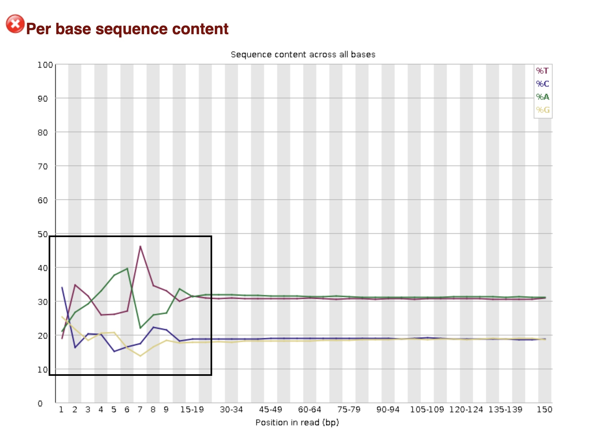

## Description of Project Experimental Design/Workflow
We are working with data obtained from Candida albicans (commensal yeast) grown in thiamine deplete (Thi-) and replete (Thi+) conditions to induce stress/virulence. 

- This is paired end data obtained from biological triplicates A, B and C.
- A1/B1/C1 all represent data from replicates/isolates grown in (Thi+) and A2/B2/C2 represent data from replicates/isolates grown in (Thi-).
- _1 & _2 are read pairs.
- Files with which I'll be working: WTC1_1.fq, WTC1_2.fq, WTC2_1.fq, WTC2_2.fq
  
### Workflow
  
 
1. Files (WTC1_1.fq, WTC1_2.fq, WTC2_1.fq, WTC2_2.fq) were analyzed by FastQC Report and cleaned accordingly using trimmomatic (removing sporadic base calling in the first ~17 bp of reads and adapter contamination, sequence duplication levels were deemed unproblematic at the levels reported and ignored).
   
  a. Scripts used to generate the FastQC Report .html files:

- [WTC1_1 FastQC Script](Scripts/FastQC/WTC1_1_fastqc.sbatch) 
- [WTC1_2 FastQC Script](Scripts/FastQC/WTC1_2_fastqc.sbatch) 
- [WTC2_1 FastQC Script](Scripts/FastQC/WTC2_1_fastqc.sbatch) 
- [WTC2_2 FastQC Script](Scripts/FastQC/WTC2_2_fastqc.sbatch) 
- [WTC1 Trimmomatic Script](Scripts/Trimmomatic/WTC1_trim.sbatch) 
- [WTC2 Trimmomatic Script](Scripts/Trimmomatic/WTC2_trim.sbatch) 
  
 
  b. FastQC Report .html files: 
  
  [WTC1_1 FastQC Report](Files/Input_File_FastQC/WTC1_1_fastqc.html) 
  [WTC1_2 FastQC Report](Files/Input_File_FastQC/WTC1_2_fastqc.html) 
  [WTC2_1 FastQC Report](Files/Input_File_FastQC/WTC2_1_fastqc.html) 
  [WTC2_2 FastQC Report](Files/Input_File_FastQC/WTC2_2_fastqc.html) 
   
  
  c. Trimmomatic scripts:  
  
* [WTC1 Trimmomatic Script](Scripts/Trimmomatic/WTC1_trim.sbatch) 
* % reads lost cleaning = 3.03% for WTC1_1.fq and WTC1_2.fq 
 
* [WTC2 Trimmomatic Script](Scripts/Trimmomatic/WTC2_trim.sbatch) 
* % reads lost cleaning = 3.54% for WTC2_1.fq and 5.05% for WTC2_2.fq 
  

  d. These scripts generated files: 
 
- WTC1_1_paired.fq 
- WTC1_1_unpaired.fq 
- WTC1_2_paired.fq 
- WTC1_2_unpaired.fq 

- WTC2_1_paired.fq 
- WTC2_1_unpaired.fq 
- WTC2_2_paired.fq 
- WTC2_2_unpaired.fq 
  
 
  e. Options used and rationale: 
* HEADCROP:17 - Removes the first 17 bases of every read, as per-base sequence content was uneven up to roughly this position. 
ex. 
Before HEADCROP: 
 
After HEADCROP 
 
* TRAILING:15 - Removes bases from the 3' end of a read while their quality score is below 15, stopping at the first base at or above the threshold; bases between positions 17 and 135 were acceptable and did not require trimming with this command. 
* ILLUMINACLIP:$loc_adapters:2:30:10 - Trims Illumina adapter sequence from reads, using the adapter sequences in TruSeq3-PE.fa. The numbers set the seed mismatch allowance (2), the palindrome clip threshold for paired-end adapter read-through (30), and the simple clip threshold (10). 
* SLIDINGWINDOW:4:15 - Scans along the read with a sliding window, cutting the read once the average quality within the window falls below a threshold; 4 is the window size in bases and 15 is the quality threshold. 
* MINLEN:75 - Discards a read entirely if it is shorter than 75 bases after all other trimming steps have been applied. 
* ORDER OF COMMANDS MATTERS! Trimmomatic applies steps in the order given. MINLEN should come last, so that length filtering is applied to the final trimmed read. 
  
 _
  
  

2. Cleaned files were then analyzed again via FastQC Report and their effectiveness assessed. After analysis, trimmomatic results were deemed sufficient to proceed with workflow (minor adapter contamination remained, sequence duplication levels were deemed unproblematic at the levels reported and ignored). Only paired.fq files/trimmomatic outputs were considered.

  a. Scripts used to generate the FastQC Report .html files:

- [WTC1_1 Paired Trimmomatic Output Script](Scripts/WTC1_1_paired_fastqc.sbatch) 
- [WTC1_2 Paired Trimmomatic Output Script](Scripts/WTC1_2_paired_fastqc.sbatch) 
- [WTC2_1 Paired Trimmomatic Output Script](Scripts/WTC2_1_paired_fastqc.sbatch) 
- [WTC2_2 Paired Trimmomatic Output Script](Scripts/WTC2_2_paired_fastqc.sbatch) 

  b. FastQC Report .html files:  

- [WTC1_1 Trimmed FastQC Report](Files/Trimmed_FastQC/WTC1_1_paired_fastqc.html) 
- [WTC1_2 Trimmed FastQC Report](Files/Trimmed_FastQC/WTC1_2_paired_fastqc.html) 
- [WTC2_1 Trimmed FastQC Report](Files/Trimmed_FastQC/WTC2_1_paired_fastqc.html) 
- [WTC2_2 Trimmed FastQC Report](Files/Trimmed_FastQC/WTC2_2_paired_fastqc.html) 
  
_
  
  
 
3. Aligned reads to C. albicans reference genome assembly ASM18296v3 from NCBI (fasta file GCF_000182965.3_ASM18296v3_genomic.fna) using bowtie2/2.5.4 and samtools/1.24

  a. First, we built an index to run the alignment using this UNIX command on the Georgetown University HPC cluster:
  
qo8@m12-base1-4 $ bowtie2-build GCF_000182965.3_ASM18296v3_genomic.fna C_alb

  b. Index files generated: 
  
- C_alb.1.bt2 
- C_alb.2.bt2 
- C_alb.3.bt2 
- C_alb.4.bt2 
- C_alb.rev.1.bt2 
- C_alb.rev.2.bt2 

  c. After index construction, trimmed reads were aligned and put into SAM format using the scripts below: 
  
- [WTC1 Alignment Script](Scripts/RNAseq_bowtie2_WTC1.sbatch) 
- [WTC2 Alignment Script](Scripts/RNAseq_bowtie2_WTC2.sbatch) 
  
  d. Scripts generated files: 
  
- WTC1.sam 
- WTC2.sam 
  
_
  
  

4. SAM files were converted to BAM files for more efficient analysis using samtools/1.24. After conversion to BAM format, files were sorted and indexed. 

  a. UNIX commands used for conversion from SAM to BAM format: 

- qo8@m12-base1-4 $ samtools view -S -b WTC1.sam > WTC1.bam 
- qo8@m12-base1-4 $ samtools view -S -b WTC2.sam > WTC2.bam 

  b. Files generated from these commands: 

- WTC1.bam 
- WTC2.bam 

  c. UNIX commands used for the sorting of BAM files: 

- qo8@m12-base1-4 $ samtools sort WTC1.bam -o WTC1.srt.bam 
- qo8@m12-base1-4 $ samtools sort WTC2.bam -o WTC2.srt.bam 

  d. Files generated from these commands: 

WTC1.srt.bam 
* Concordant alignment rate (exactly one time) = 89.01% 
 
WTC2.srt.bam 
* Concordant alignment rate (exactly one time) = 89.41% 

  e. UNIX commands used for the indexing of BAM files: 

- qo8@m12-base1-4 $ samtools index WTC1.srt.bam 
- qo8@m12-base1-4 $ samtools index WTC2.srt.bam 
  
* This SAM to BAM conversion can also be included in and written into the scripts used to generate the SAM files without going through the intermediate UNIX commands described in this step of the workflow.
  
_
  
  

5. Sorted BAM files were used to generate per-gene read counts using htseq-count (HTSeq) run from a conda environment. Counts were made against the C. albicans annotation file GCF_000182965.3_ASM18296v3_genomic.gtf from NCBI (same assembly used for the bowtie2 index in step 3).

  a. Scripts used to generate count files:
[WTC1 htseq-count Script](Scripts/htseq/WTC1_htseq-count.sbatch)
[WTC2 htseq-count Script](Scripts/htseq/WTC1_htseq-count.sbatch)

  b. Options used and rationale:
* -r pos: input BAM files are position-sorted (see step 4c)
* -s no: data is not from a strand-specific protocol; the htseq-count default (-s yes) would discard roughly half of all reads
* -t exon: counts reads overlapping features labeled "exon" in column 3 of the GTF
* -i gene_id: groups exons belonging to the same gene using the gene_id attribute, so counts are reported per gene

  c. Scripts generated files: 

- WTC1_htseq-count 
- WTC2_htseq-count 

  d. Summary of counting results: 

WTC1_htseq-count 
- 20123585 alignment record pairs processed 
- __no_feature	325790 
- __ambiguous	269578 
- __too_low_aQual	1245864 
- __not_aligned	253960 
- __alignment_not_unique	0 

WTC2_htseq-count 
- 19684786 alignment record pairs processed 
- __no_feature	357846 
- __ambiguous	267917 
- __too_low_aQual	1206192
- __not_aligned	304125 
- __alignment_not_unique	0 

e. Output format: each file is a two-column table of gene ID and read-pair count, followed by the five special counters listed above. These count tables are the input for differential expression analysis between the Thi+ (WTC1) and Thi- (WTC2) conditions. 

  
 _
   
   
  
 
